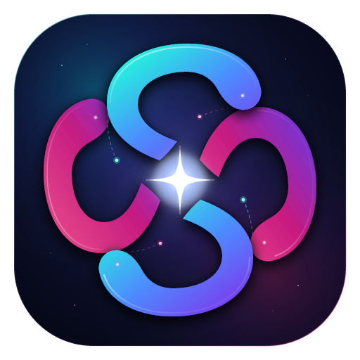
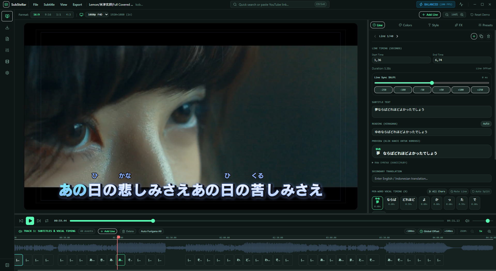
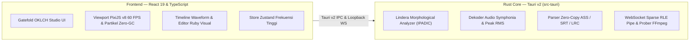

<div align="center">



# SubStellar

### Studio Subtitle Animasi & Partikel Generasi Berikutnya

**[English](README.md)** • **[Bahasa Indonesia](README.id.md)** • **[日本語](README.ja.md)** • **[简体中文](README.zh-CN.md)**

[](LICENSE)
[](https://tauri.app)
[](https://www.rust-lang.org)
[](https://react.dev)
[](https://pixijs.com)
[](https://www.typescriptlang.org)
[](#)
[](#)

*Software desktop profesional untuk pembuatan subtitle & video lirik tingkat lanjut dengan efek partikel kosmik, pendaran glow berlapis, Furigana otomatis native, sinkronisasi vokal per-kata/per-huruf, dan integrasi YouTube 1-klik, ditenagai oleh Rust Core dan dibalut desain visual Gatefold yang elegan.*

[Fitur Utama](#fitur-utama) • [Arsitektur Rust Core](#arsitektur-rust-core) • [Tech Stack](#tech-stack) • [Memulai Cepat](#memulai-build-dari-source) • [Shortcut Keyboard](#shortcut-keyboard) • [Lisensi](#lisensi--penghargaan)

<br />

<p align="center">
  
</p>
<p align="center">
  <sub><i>Gatefold OKLCH Studio — Furigana Jepang Native, Timing Vokal Per-Kata, Viewport PixiJS v8 60 FPS & Timeline Waveform RMS</i></sub>
</p>

</div>

---

## Mengapa SubStellar?

Membuat video lirik lagu beranimasi estetik saat ini terpecah di dua kutub ekstrem:
* **Terlalu Sulit:** Software subtitle klasik (**Aegisub**) membutuhkan keahlian script Lua rumit (`kara-templater` / `PyonFX`).
* **Terlalu Kaku & Berat:** Editor mainstream (**CapCut / Premiere / After Effects**) tidak memiliki dukungan bawaan untuk Furigana (bacaan hiragana di atas kanji), boros RAM (sering memakan 16 GB+), dan lambat untuk sinkronisasi lirik manual per kata.

**SubStellar** hadir sebagai solusi seimbang: **Semudah 1-klik di CapCut, seindah efek partikel di After Effects, seringan Aegisub**—bahkan dapat berjalan mulus (60 FPS konstan) di laptop low-end dengan RAM 4 GB dan Intel HD Graphics.

---

## Fitur Utama

- **Engine Komputasi Rust Core Berkecepatan Tinggi:** Operasi pemrosesan data berat (analisis morfologi bahasa Jepang, ekstraksi puncak waveform audio, dan parsing subtitle) dijalankan langsung di Rust native untuk eksekusi instan dan hemat RAM tanpa beban Garbage Collector.
- **Tokenizer Furigana Jepang Native (`Lindera` + IPADIC):** Tokenisasi kanji ke hiragana/romaji akurat menggunakan kamus terkompresi tanpa membebani heap browser.
- **Ekstraksi Puncak Waveform RMS Dinamis (`Symphonia` + FFmpeg):** Decoding audio native dengan downsampling gabungan energi RMS dan rata-rata puncak untuk menampilkan dinamika lagu secara jelas tanpa terpotong (anti-clipping).
- **1-Klik Unduh Video & Audio YouTube (`yt-dlp`):** Cukup tempel tautan YouTube, pilih resolusi video (`360p` hingga `4K`) atau ekstrak audio saja, lalu unduh langsung ke dalam studio lengkap dengan ekstraksi thumbnail & palet warna otomatis tanpa perlu Google API Key.
- **Multi-Source Synced Lyrics:** Pencarian lirik otomatis dari 5 database online (LRCLIB, NetEase Cloud Music, QQ Music, Kugou, Musixmatch) serta impor file lokal `.lrc`, `.srt`, dan `.vtt` via parser Rust zero-copy.
- **Kontrol Vocal Timing Per-Kata & Per-Huruf Presisi Tinggi:**
  - Deteksi otomatis per-kata dan karakter CJK (Jepang/Mandarin).
  - **Pisah & Gabung Kata/Huruf:** Pecah kata menjadi per-huruf (`Split to Chars` / `All Chars`) atau gabungkan huruf/tanda baca bersebelahan (`← Merge Left` / `Merge Right →`).
  - **Matikan Animasi per Area Kata:** Nonaktifkan animasi vokal pada kata atau tanda baca tertentu (`Anim: OFF (Static)`) agar area tersebut tetap diam tanpa memicu lompatan atau partikel.
  - **Gaya Transisi Antar-Kata:** Pilihan animasi **Pop Bounce**, **Karaoke Sweep**, **Smooth Sweep**, dan **Vocal Float** dengan durasi transisi (`0ms–500ms`) serta pembatas kata yang bisa digeser langsung di atas waveform timeline.
- **Furigana / Ruby Text & Terjemahan Baris Kedua:** Dukungan sintaks `{漢字|かんじ}` dengan editor visual klik-untuk-edit serta teks terjemahan sekunder yang tampil bersamaan.
- **Real-Time Particle Engine Zero-GC (PixiJS v8):** Partikel bintang (*stardust*), kelopak sakura, dan bara kosmik yang meletup mengikuti ketukan vokal pada 60 FPS stabil tanpa kebocoran memori (RAM leak).
- **Kustomisasi Warna, Gradasi & Posisi X/Y Tanpa Batas:** Atur warna isi, warna kata aktif, warna gradasi, ketebalan stroke ganda, anchor vertikal (`Bottom` / `Center` / `Top`), serta posisi `X/Y Offset` bebas menggunakan slider maupun input angka langsung.
- **Layout Gatefold & Sidebar Kanan Resizable:** Antarmuka gelap obsidian dengan menu bar editor klasik (`File`, `Subtitle`, `View`, `Export`), timeline multi-lane anti-tumpuk, serta pembatas antara preview video dan sidebar tool kanan yang bisa digeser-geser ukurannya.
- **Simpan Proyek Native & Render Video Hardware (FFmpeg):**
  - Simpan dan buka file proyek `.substellar` melalui jendela Windows Explorer (`Save` / `Save As` / `Open`), dilengkapi pemulihan otomatis proyek dan video terakhir saat aplikasi dibuka kembali.
  - **Full Canvas Overlay Pipe (WebSocket Sparse RLE):** Aliran frame canvas render ke FFmpeg lokal dengan efisiensi tinggi dan paritas warna 100% WYSIWYG (matriks warna BT.709).
  - **Fast Hardware ASS Burn-In:** Render video langsung memanfaatkan GPU (`NVENC` / `QSV` / `AMF` / `libx264`) dengan burn-in teks subtitle berlapis.
  - **Ekspor Subtitle Jelas & Informatif:** Ekspor native Rust ke `.ass` (dengan tag karaoke `\k` lengkap) dan `.srt` dengan dialog pemilihan target dan tombol **Buka di Explorer**.

---

## Arsitektur Rust Core

SubStellar memisahkan tugas UI dan komputasi intensif dengan arsitektur dua lapisan:



---

## Tech Stack

| Lapisan | Pilihan Teknologi | Peran |
| :--- | :--- | :--- |
| **Desktop Shell & Core** | **Tauri v2 (Rust 1.94+)** | Runtime ringan, dialog file native OS, manajemen proses aman, dan mesin komputasi native. |
| **Frontend** | **React 19 + TypeScript (Strict)** | UI deklaratif studio, strict type safety, dan pemutaran bebas re-render. |
| **Rendering Canvas** | **PixiJS v8 (WebGPU / WebGL)** | Engine subtitle & partikel 60 FPS tanpa alokasi tekstur berulang per frame. |
| **Desain & Theming** | **Tailwind CSS + Gatefold OKLCH** | Sistem warna OKLCH dan ekstraksi palet ambient dinamis. |
| **State Management** | **Zustand** | Sinkronisasi timecode 60 FPS (`getState()` di RAF) tanpa membebani React. |
| **NLP & Furigana** | **Lindera (Rust) + Kuromoji Fallback** | Tokenisasi kanji Jepang secara native dengan kamus memori-mapped teroptimasi. |
| **Pemrosesan Audio** | **Symphonia (Rust) + Web Worker** | Decoding audio native dan downsampling puncak waveform RMS untuk visualisasi timeline. |
| **Media Processing** | **FFmpeg (Native / Sidecar)** | Deteksi hardware encoder (`NVENC`/`QSV`/`AMF`), sparse RLE frame pipe, dan burn-in ASS. |
| **Downloader** | **yt-dlp + Rust Allowlist Proxy** | Pengunduhan video/audio YouTube multi-resolusi dan proxy pencarian lirik. |

---

## Memulai (Build dari Source)

### 1. Prasyarat Umum
* [Node.js](https://nodejs.org/) v20+ atau v24+
* [Rust & Cargo](https://rustup.rs/) v1.80+ (v1.94+ direkomendasikan)
* [FFmpeg](https://ffmpeg.org/) & [yt-dlp](https://github.com/yt-dlp/yt-dlp) tersedia di `PATH` sistem (untuk fitur render video dan unduh YouTube)

### 2. Persiapan per Sistem Operasi

<details open>
<summary><strong>Windows (10 / 11)</strong></summary>

1. Pasang **[Visual Studio C++ Build Tools](https://visualstudio.microsoft.com/visual-cpp-build-tools/)** dan pilih *workload* **"Desktop development with C++"**.
2. Pastikan **[Microsoft Edge WebView2](https://developer.microsoft.com/en-us/microsoft-edge/webview2/)** terpasang (sudah tersedia bawaan di Windows 11 dan Windows 10 terbaru).
3. Pasang `FFmpeg` dan `yt-dlp` (misalnya melalui `winget`):
   ```powershell
   winget install Gyan.FFmpeg yt-dlp.yt-dlp
   ```

</details>

<details>
<summary><strong>macOS (Apple Silicon / Intel)</strong></summary>

1. Pasang Xcode Command Line Tools:
   ```bash
   xcode-select --install
   ```
2. Pasang `FFmpeg` dan `yt-dlp` melalui Homebrew:
   ```bash
   brew install ffmpeg yt-dlp
   ```

</details>

<details>
<summary><strong>Linux (Ubuntu / Debian / Fedora / Arch)</strong></summary>

1. Pasang dependensi WebKitGTK Tauri v2, *build tools*, `FFmpeg`, dan `yt-dlp`:
   ```bash
   # Ubuntu / Debian
   sudo apt update && sudo apt install -y \
     libwebkit2gtk-4.1-dev build-essential curl wget file \
     libxdo-dev libssl-dev libayatana-appindicator3-dev librsvg2-dev \
     ffmpeg yt-dlp
   ```
   *(Untuk **Fedora**, gunakan `webkit2gtk4.1-devel` + `@development-tools`; untuk **Arch**, gunakan `webkit2gtk-4.1` + `base-devel`.)*

</details>

### 3. Kloning, Jalankan & Build

```bash
# 1. Kloning repositori
git clone https://github.com/SayMaven/sub-stellar.git
cd sub-stellar

# 2. Pasang dependensi frontend
npm install

# 3. Jalankan aplikasi desktop Tauri v2 dalam mode pengembang
npm run tauri dev

# 4. Atau kompilasi installer produksi native
npm run tauri build
```

Hasil installer akan tersimpan di folder `src-tauri/target/release/bundle/`:
* **Windows:** `msi/` (`.msi`) & `nsis/` (`.exe`)
* **macOS:** `dmg/` (`.dmg`) & `macos/` (`.app`)
* **Linux:** `deb/` (`.deb`) & `appimage/` (`.AppImage`)

---

## Shortcut Keyboard

| Shortcut | Aksi |
| :--- | :--- |
| **`Space`** | Putar / Jeda pemutaran media |
| **`Ctrl + N`** | Tambah baris subtitle kosong di posisi playhead |
| **`Ctrl + S`** | Simpan Proyek (`.substellar`) |
| **`Ctrl + Shift + S`** | Simpan Proyek Sebagai (`.substellar`) |
| **`Delete`** | Hapus baris subtitle yang dipilih |
| **`Ctrl + K`** | Buka Pengunduh Media YouTube |
| **`Ctrl + Q`** | Ganti Profil Kualitas Perangkat (`Low` / `Balanced` / `Ultra`) |
| **`Ctrl + Shift + D`** | Tampilkan/Sembunyikan Telemetri Performa Real-Time (FPS, Frame Time, Partikel) |

---

## Lisensi & Penghargaan

SubStellar didistribusikan dengan lisensi ganda:

* **[MIT License](LICENSE-MIT)** ([http://opensource.org/licenses/MIT](http://opensource.org/licenses/MIT))
* **[Apache License, Version 2.0](LICENSE-APACHE)** ([http://www.apache.org/licenses/LICENSE-2.0](http://www.apache.org/licenses/LICENSE-2.0))

Lihat file [LICENSE](LICENSE) untuk detail lengkap.

**Penghargaan & Inspirasi:**
* **[Gatefold](https://github.com/DEVIROYrus/gatefold-foobar2000):** Inspirasi bahasa desain OKLCH dan arsitektur pencarian lirik multi-sumber.
* **[PixiJS](https://pixijs.com):** Engine rendering 2D WebGL/WebGPU berperforma tinggi.
* **[Tauri](https://tauri.app):** Framework desktop cross-platform yang aman dan ringan.
* **[Lindera](https://github.com/lindera/lindera):** Pustaka analisis morfologi bahasa Jepang berkecepatan tinggi dalam Rust.
* **[Symphonia](https://github.com/pdeljanov/Symphonia):** Pustaka decoding audio murni dalam Rust.
