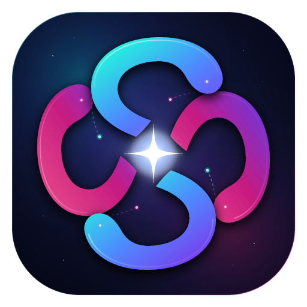
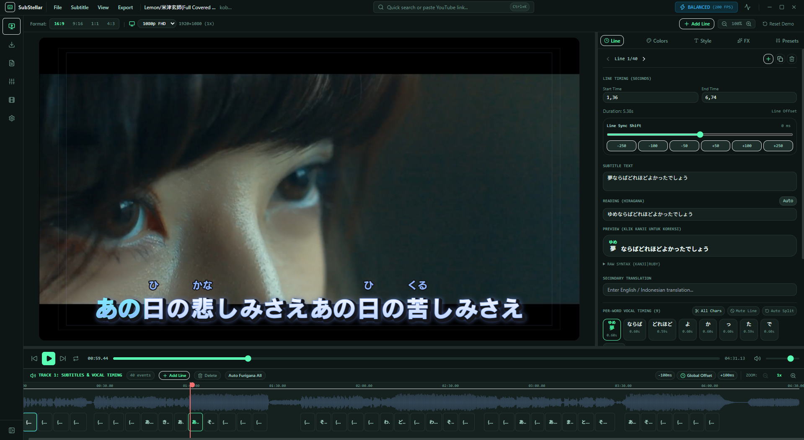
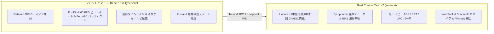

<div align="center">



# SubStellar

### 次世代アニメーション＆パーティクル字幕スタジオ

**[English](README.md)** • **[Bahasa Indonesia](README.id.md)** • **[日本語](README.ja.md)** • **[简体中文](README.zh-CN.md)**

[](LICENSE)
[](https://tauri.app)
[](https://www.rust-lang.org)
[](https://react.dev)
[](https://pixijs.com)
[](https://www.typescriptlang.org)
[](#)
[](#)

*宇宙のようなパーティクル演出、二重縁取りグロー文字、ネイティブRustによる自動ルビ（ふりがな）形態素解析、単語・文字単位のボーカル同期、そして1クリックYouTube連携を備えた、Gatefoldデザインのプロフェッショナル歌詞・字幕制作デスクトップスタジオ。*

[主な機能](#主な機能) • [Rust Core アーキテクチャ](#rust-core-エンジン) • [技術スタック](#技術スタック) • [クイックスタート](#クイックスタートソースからのビルド) • [キーボードショートカット](#キーボードショートカット) • [ライセンス](#ライセンスと謝辞)

<br />

<p align="center">
  
</p>
<p align="center">
  <sub><i>Gatefold OKLCH スタジオ — ネイティブ日本語ふりがな、単語別ボーカル同期、PixiJS v8 60 FPS ビューポート＆RMS 波形タイムライン</i></sub>
</p>

</div>

---

## なぜ SubStellar なのか？

表現力豊かなMV（ミュージックビデオ）やアニメーション歌詞動画を作る際、従来のツールには大きな課題がありました：
* **難易度が高すぎる：** 古典的な字幕ソフト（**Aegisub**）では、高度なエフェクトを作るために複雑なLuaスクリプト（`kara-templater` / `PyonFX`）を書く必要があります。
* **重すぎて柔軟性に欠ける：** 一般的な動画編集ソフト（**CapCut / Premiere Pro / After Effects**）は、日本語のふりがな（ルビ）に標準対応しておらず、大量のメモリ（16GB以上）を消費し、1語ずつの細かなタイミング調整に手間がかかります。

**SubStellar** はその両方の長所を融合しました：**CapCutのように直感的で、After Effectsのように美しく、Aegisubのように軽量**。メモリ4GB・内蔵GPUのノートPCでも安定した60 FPSで動作するよう設計されています。

---

## 主な機能

- **高性能 Rust Core エンジン：** 日本語形態素解析、音声波形ピーク抽出、字幕ファイルのパース・生成などの高負荷処理をネイティブRustで実行。ブラウザのGC負荷をゼロにし、超高速レスポンスと低メモリ消費を実現。
- **ネイティブ日本語ふりがなトークナイザー (`Lindera` + 辞書内蔵)：** 高速かつ高精度な形態素解析により、V8ヒープを圧迫することなく漢字からひらがな・ローマ字のルビを瞬時に生成。
- **ダイナミック RMS 音声波形抽出 (`Symphonia` + FFmpeg)：** 音声デコードにSymphoniaを採用し、RMS（実効値）と平均ピークを組み合わせたダウンサンプリングにより、音圧の高い現代の楽曲でも海苔波形にならず楽曲の抑揚を美しく可視化。
- **1クリック YouTube 動画・音声ダウンロード (`yt-dlp`)：** YouTubeのURLを貼り付け、解像度（`360p`〜`4K`）または音声のみを選択して直接スタジオにダウンロード。APIキー不要でサムネイルとアンビエント配色も自動抽出します。
- **マルチソース同期歌詞エンジン：** 5つのオンライン歌詞データベース（LRCLIB、NetEase Cloud Music、QQ Music、Kugou、Musixmatch）からの自動検索・インポートに加え、Rustゼロコピーパーサーによるローカル `.lrc` / `.srt` / `.vtt` ファイル読み込みに対応。
- **単語・文字単位の精密ボーカルタイミング制御：**
  - 日本語（漢字・かな）・英語・中国語に対応したスマート自動トークン分割。
  - **文字分割＆結合コントロール：** 選択した単語を1文字ずつに分割（`Split to Chars` / `All Chars`）、または隣接する文字や記号を結合（`← Merge Left` / `Merge Right →`）。
  - **エリア別アニメーション無効化（ミュート）：** 句読点や特定の単語だけアニメーションをオフ（`Anim: OFF (Static)`）にし、バウンスやパーティクルを出さずに静止表示させることが可能。
  - **トランジションスタイル：** **Pop Bounce**、**Karaoke Sweep**、**Smooth Sweep**、**Vocal Float** から選択でき、遷移時間（`0ms〜500ms`）や波形タイムライン上での単語境界ドラッグ調整に対応。
- **ふりがな（ルビ）＆二段翻訳字幕：** `{漢字|かんじ}` 記法とクリック編集エディタによる正確なルビ配置、およびメイン歌詞の下に表示される翻訳（サブテキスト）編集をサポート。
- **Zero-GC リアルタイム・パーティクルエンジン (PixiJS v8)：** オブジェクトプーリングとGPUテクスチャ再利用により、メモリリークを起こさず60 FPSで星屑・桜吹雪・光の粒子をボーカルに合わせて放出。
- **自由自在なタイポグラフィ＆X/Y座標オフセット：** 文字色、歌唱中ハイライト色、グラデーション、二重ストローク縁取り、配置基準（`Bottom` / `Center` / `Top`）、制限なしの `X/Y` ピクセルオフセットをスライダーと数値直接入力の両方で調整可能。
- **Gatefold 3ゾーンUI＆リサイズ可能な右サイドバー：** OKLCHカラースペースに基づくダークUI、標準メニューバー（`File` / `Subtitle` / `View` / `Export`）、重なりを自動解消するマルチレーンタイムライン、ドラッグで幅を自由に変更できる右インスペクターを搭載。
- **ネイティブプロジェクト保存＆ハードウェア動画レンダリング (FFmpeg)：**
  - OS標準のファイルダイアログによる `.substellar` プロジェクトの保存・読み込みと、次回起動時の自動復元（動画キャッシュ含む）。
  - **Full Canvas Overlay Pipe (WebSocket Sparse RLE)：** レンダリングされたキャンバスフレームをローカルFFmpegへ高速ストリーミングし、正確なBT.709色空間で完全なWYSIWYG動画を出力。
  - **Fast Hardware ASS Burn-In：** GPUアクセラレーション（`NVENC` / `QSV` / `AMF` / `libx264`）によるマルチレイヤーASS字幕の超高速動画焼き付け。
  - **字幕ファイル出力：** Rustによる高速 `.ass`（ルビ＆`\k`タグ付き）・`.srt` 出力と、完了後の**エクスプローラーで表示**機能。

---

## Rust Core エンジン

SubStellar は重い処理を TypeScript フロントエンドから **Rust Core** (`src-tauri/`) へオフロードしています：



---

## 技術スタック

| レイヤー | 採用技術 | 役割 |
| :--- | :--- | :--- |
| **デスクトップシェル＆コア** | **Tauri v2 (Rust 1.94+)** | ネイティブランタイム、OSファイルダイアログ、安全なプロセス管理、コア計算処理。 |
| **フロントエンド** | **React 19 + TypeScript (Strict)** | 宣言的スタジオUI、厳格な型安全性、再レンダリング負荷ゼロの再生ループ。 |
| **描画キャンバス** | **PixiJS v8 (WebGPU / WebGL)** | ゼロアロケーション60 FPS字幕レイアウト、二重縁取り描画、パーティクル演出。 |
| **デザイン＆テーマ** | **Tailwind CSS + Gatefold OKLCH** | 知覚的に均一なOKLCHカラートークンと動的アンビエント配色抽出。 |
| **状態管理** | **Zustand** | Reactツリーを再描画せずに60 FPSの再生位置を同期。 |
| **自然言語処理・ルビ** | **Lindera (Rust) + Kuromoji Fallback** | ネイティブ日本語形態素解析と軽量ふりがな生成。 |
| **音声処理** | **Symphonia (Rust) + Web Worker** | ネイティブ音声デコードとRMS波形ピーク生成。 |
| **メディア処理・出力** | **FFmpeg (Native / Sidecar)** | ハードウェアエンコーダ自動検出（`NVENC`/`QSV`/`AMF`）、Sparse RLE フレームパイプ、ASS焼き付け。 |
| **ダウンローダー** | **yt-dlp + Rust Allowlist Proxy** | 解像度選択対応YouTubeダウンロードおよび安全な歌詞取得プロキシ。 |

---

## クイックスタート（ソースからのビルド）

### 1. 共通の動作要件
* [Node.js](https://nodejs.org/) v20+ または v24+
* [Rust & Cargo](https://rustup.rs/) v1.80+（v1.94以上推奨）
* システムの `PATH` に [FFmpeg](https://ffmpeg.org/) および [yt-dlp](https://github.com/yt-dlp/yt-dlp) が設定されていること（動画出力およびYouTubeダウンロード用）

### 2. OS別の環境構築

<details open>
<summary><strong>Windows (10 / 11)</strong></summary>

1. **[Visual Studio C++ Build Tools](https://visualstudio.microsoft.com/visual-cpp-build-tools/)** をインストールし、**「C++ によるデスクトップ開発」** ワークロードを選択します。
2. **[Microsoft Edge WebView2](https://developer.microsoft.com/en-us/microsoft-edge/webview2/)** がインストールされていることを確認します（Windows 11 および最新の Windows 10 には標準搭載されています）。
3. `FFmpeg` と `yt-dlp` をインストールします（例：`winget` を使用）：
   ```powershell
   winget install Gyan.FFmpeg yt-dlp.yt-dlp
   ```

</details>

<details>
<summary><strong>macOS (Apple Silicon / Intel)</strong></summary>

1. Xcode Command Line Tools をインストールします：
   ```bash
   xcode-select --install
   ```
2. Homebrew で `FFmpeg` と `yt-dlp` をインストールします：
   ```bash
   brew install ffmpeg yt-dlp
   ```

</details>

<details>
<summary><strong>Linux (Ubuntu / Debian / Fedora / Arch)</strong></summary>

1. Tauri v2 に必要な WebKitGTK ライブラリ、ビルドツール、`FFmpeg`、`yt-dlp` をインストールします：
   ```bash
   # Ubuntu / Debian
   sudo apt update && sudo apt install -y \
     libwebkit2gtk-4.1-dev build-essential curl wget file \
     libxdo-dev libssl-dev libayatana-appindicator3-dev librsvg2-dev \
     ffmpeg yt-dlp
   ```
   *（**Fedora** の場合は `webkit2gtk4.1-devel` + `@development-tools`、**Arch** の場合は `webkit2gtk-4.1` + `base-devel` を使用してください。）*

</details>

### 3. クローン・起動・ビルド

```bash
# 1. リポジトリのクローン
git clone https://github.com/SayMaven/sub-stellar.git
cd sub-stellar

# 2. フロントエンド依存パッケージのインストール
npm install

# 3. Tauri v2 デスクトップ開発モードで起動
npm run tauri dev

# 4. 本番用ネイティブインストーラーをビルド
npm run tauri build
```

生成されたインストーラーは `src-tauri/target/release/bundle/` に出力されます：
* **Windows:** `msi/` (`.msi`) および `nsis/` (`.exe`)
* **macOS:** `dmg/` (`.dmg`) および `macos/` (`.app`)
* **Linux:** `deb/` (`.deb`) および `appimage/` (`.AppImage`)

---

## キーボードショートカット

| ショートカット | アクション |
| :--- | :--- |
| **`Space`** | 再生 / 一時停止 |
| **`Ctrl + N`** | 再生ヘッド位置に新規字幕行を追加 |
| **`Ctrl + S`** | プロジェクト保存 (`.substellar`) |
| **`Ctrl + Shift + S`** | 名前を付けてプロジェクト保存 (`.substellar`) |
| **`Delete`** | 選択中の字幕行を削除 |
| **`Ctrl + K`** | YouTube メディアダウンローダーを開く |
| **`Ctrl + Q`** | ハードウェア品質プロファイル切り替え (`Low` / `Balanced` / `Ultra`) |
| **`Ctrl + Shift + D`** | リアルタイムパフォーマンステレメトリ表示切替 (FPS, フレーム時間, パーティクル数) |

---

## ライセンスと謝辞

SubStellar は以下のデュアルライセンスのもとで公開されています：

* **[MIT License](LICENSE-MIT)** ([http://opensource.org/licenses/MIT](http://opensource.org/licenses/MIT))
* **[Apache License, Version 2.0](LICENSE-APACHE)** ([http://www.apache.org/licenses/LICENSE-2.0](http://www.apache.org/licenses/LICENSE-2.0))

詳細は [LICENSE](LICENSE) をご覧ください。

**謝辞とインスピレーション：**
* **[Gatefold](https://github.com/DEVIROYrus/gatefold-foobar2000):** OKLCHデザイン言語およびマルチソース歌詞機能の着想元。
* **[PixiJS](https://pixijs.com):** 高性能2D WebGL/WebGPUレンダリングエンジン。
* **[Tauri](https://tauri.app):** 軽量かつ安全なクロスプラットフォームデスクトップフレームワーク。
* **[Lindera](https://github.com/lindera/lindera):** Rust製高速日本語形態素解析ライブラリ。
* **[Symphonia](https://github.com/pdeljanov/Symphonia):** Rust製ピュアメディアデコードライブラリ。
