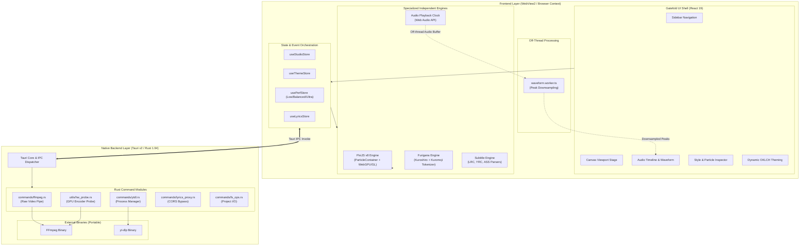
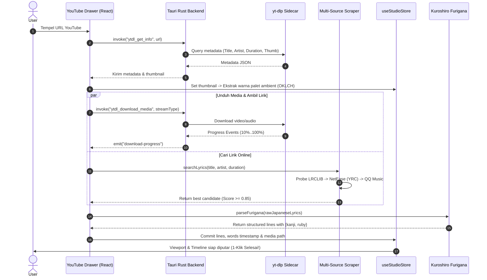
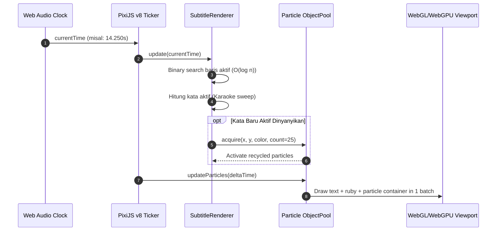
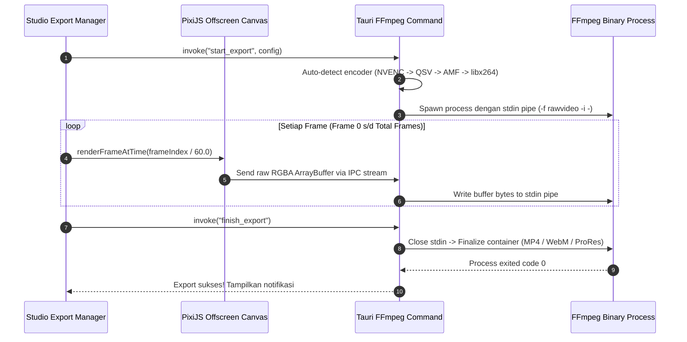

# Software Architecture & Technical Design Document: SubStellar

**Document Version:** 1.0.0  
**Status:** Approved for Implementation  
**Target Repository:** `https://github.com/SayMaven/sub-stellar`  
**Reference Design:** Gatefold Foobar2000 (`F:\CODE\forking\gatefold-foobar2000`)

---

## 1. Desain Pola Arsitektur (Architecture Pattern)

SubStellar mengadopsi arsitektur **Modular Micro-Kernel dengan Event-Driven State & Plugin-Ready Interface**.

```
+-----------------------------------------------------------------------------------+
|                        PLUGINS & EXTENSIONS (Future V2)                           |
|  [ Custom Particle Shaders ]   [ Community Lyrics Scrapers ]   [ AI Transcribers ]|
+-----------------------------------------------------------------------------------+
                                         │ (Extension APIs)
+-----------------------------------------------------------------------------------+
|                           MICRO-KERNEL & STATE ORCHESTRATOR                       |
|   Zustand Stores (Transient 60 FPS Updates)  •  Event Bus  •  Project Serializer  |
+-----------------------------------------------------------------------------------+
            │                                     │                         │
+───────────────────────+             +───────────────────────+   +─────────────────+
|   UI PRESENTATION     |             |  INDEPENDENT ENGINES  |   | NATIVE RUNTIME  |
| - Gatefold Shell      |             | - PixiJS v8 Particles |   | - Tauri v2 IPC  |
| - React 19 Components |             | - Furigana / Kuroshiro|   | - FFmpeg Pipe   |
| - OKLCH Theme Engine  |             | - Web Audio Waveform  |   | - yt-dlp Sidecar|
| - Timeline Scrubber   |             | - Subtitle ASS/LRC    |   | - HW Probe      |
+───────────────────────+             +───────────────────────+   +─────────────────+
```

### Mengapa Bukan Pure Monolith atau Full Microservices?
1. **Bukan Pure Monolith Kaku:** Jika engine rendering, parsing audio, dan UI disatukan secara monolitik, proses berat (seperti ekstraksi audio waveform atau alokasi ribuan partikel) akan memicu jank dan freeze pada UI thread.
2. **Bukan Heavy Microservices:** Overhead network inter-process akan boros memori pada laptop low-end.
3. **Pilihan Terbaik: Modular Micro-Kernel:**
   - **Inti (*Kernel*):** Mengelola siklus hidup proyek, status playback audio, dan sinkronisasi data antar modul melalui Zustand state bus.
   - **Modul Terisolasi (*Engines*):** Setiap modul (Furigana, Waveform, PixiJS Viewport, FFmpeg Pipeline) memiliki batasan tanggung jawab yang ketat (*loose coupling*) dan dapat diuji secara independen.

---

## 2. Diagram Arsitektur Sistem (System Architecture Diagram)



---

## 3. Data Flow & Component Diagrams

### 3.1 Alur Data: 1-Klik Unduh YouTube & Auto-Sync Lirik


### 3.2 Alur Data: Render Loop 60 FPS (Playback & Emisi Partikel)


### 3.3 Alur Data: Pipeline Ekspor Video Tanpa File Sementara (Zero Temp Disk I/O)


---

## 4. Justifikasi Pemilihan Teknologi (Technology Stack Justification)

### 4.1 Mengapa Tauri v2, Bukan Electron?
* **Penggunaan Memori (Memory Footprint):**
  - Electron membundel Chromium lengkap (~150MB binary, 400MB+ RAM saat buka jendela).
  - Tauri v2 memanfaatkan **Microsoft Edge WebView2** yang sudah terpasang secara native di semua Windows 10 & 11. RAM awal hanya **~30–60 MB**.
* **Keamanan & Performa Native:**
  - Backend ditulis dengan **Rust** (memory safe, zero-cost abstractions, tidak ada garbage collector).
  - Kemampuan streaming buffer gambar mentah ke proses FFmpeg via IPC Rust tanpa hambatan bottleneck Node.js C++ bindings.

### 4.2 Mengapa React 19 + TypeScript, Bukan Svelte atau Vue?
* **Ekosistem Canvas & Editor yang Terkaya:** Ekosistem komponen UI berbasis web audio, slider scrubber, modal, dan timeline editor paling matang di dunia ada di React (Radix UI, Lucide, Tailwind).
* **React 19 Actions & Compiler:** Mengurangi overhead re-render manual.
* **Strict Type Safety:** Menghindari bug runtime pada struktur data subtitle yang kompleks (`RubyPair`, `SubtitleWord`, `ParticleEmitterConfig`).

### 4.3 Mengapa PixiJS v8, Bukan Three.js atau Canvas 2D Biasa?
* **Kecepatan Rendering 2D:** PixiJS v8 dibangun khusus untuk 2D dengan arsitektur pipeline WebGPU/WebGL generasi terbaru.
* **`ParticleContainer` Bawaan:** Mampu merender ribuan sprite partikel dengan **1 draw call** (batch rendering). Three.js terlalu berat (overhead 3D scene-graph) untuk kebutuhan subtitle 2D, sementara Canvas 2D biasa drop ke <15 FPS saat menggambar ratusan partikel dengan blend mode pendaran cahaya.
* **Text Metrics & Kerning Akurat:** Memiliki engine teks tingkat tinggi untuk mengukur pixel width kanji dan menempatkan ruby text tepat di tengah.

### 4.4 Mengapa Web Audio API, Bukan Library Audio Native C++?
* **Zero-Latency Visualizer:** Web Audio API terintegrasi langsung di dalam webview, memungkinkan visualisasi waveform dan FFT spectrum tersinkronisasi presisi frame-by-frame dengan canvas PixiJS tanpa latency context-switch antara OS dan UI.

---

## 5. Pemisahan Tanggung Jawab (Separation of Concerns - SoC)

Setiap lapisan dalam SubStellar memiliki batas tanggung jawab (*boundaries*) yang jelas:

| Layer | Komponen Utama | Yang BOLEH Dilakukan | Yang DILARANG Dilakukan |
| :--- | :--- | :--- | :--- |
| **UI Presentation** | `src/components/` | Menampilkan data secara deklaratif, menerima input user, menerapkan tema Gatefold. | Dilarang menjalankan loop animasi partikel atau memproses buffer audio biner. |
| **State / Logic** | `src/stores/` (Zustand) | Menyimpan konfigurasi proyek, status pemutaran, data lirik, memicu aksi. | Dilarang memanipulasi elemen DOM atau Canvas secara langsung. |
| **Rendering Engine** | `src/engine/pixi/` | Merender teks, furigana, efek glow, dan partikel pada 60 FPS di WebGL/WebGPU. | Dilarang bergantung pada state React; hanya menerima perintah data murni. |
| **Audio Engine** | `src/engine/audio/` | Mengatur jam pemutaran master (`currentTime`), play/pause audio, Web Worker waveform. | Dilarang mengolah styling UI atau manipulasi file video. |
| **Subtitle Engine** | `src/engine/parsers/` | Parsing dan serialisasi format ASS, LRC, YRC, SRT, serta kalkulasi bounds ruby. | Dilarang berinteraksi langsung dengan kanvas grafis atau filesystem. |
| **Native Backend** | `src-tauri/` (Rust) | Menjalankan binary FFmpeg/yt-dlp, probing hardware, baca/tulis disk, bypass CORS. | Dilarang mencampuri logika bisnis tampilan lirik. |

---

## 6. Offline-First vs Fitur Online

SubStellar memegang prinsip **100% Offline-First**:

```
+─────────────────────────────────────────────────────────────────────────────+
|                         OFFLINE-FIRST CORE (100% Mandiri)                   |
| • Pemutaran Video & Audio Lokal (.mp4, .mkv, .mp3, .flac, .wav)             |
| • Pembuatan, Editing, dan Penyesuaian Timing Subtitle Manual                |
| • Auto-Generate Furigana (Kamus Kuromoji lokal di public/dict/)             |
| • Real-time Particle & Glow Rendering Engine                                |
| • Export Video Burn-in MP4 & Transparent Alpha (FFmpeg lokal)               |
| • Import & Export File .ass, .srt, .lrc                                     |
+─────────────────────────────────────────────────────────────────────────────+
                                       ▲
                        (Progressive Enhancements)
                                       ▼
+─────────────────────────────────────────────────────────────────────────────+
|                          FITUR ONLINE OPSIONAL                              |
| • Auto-Search & Download YouTube Video/Audio via yt-dlp                     |
| • Multi-Source Online Lyrics Scraper (LRCLIB, NetEase, QQ, Kugou)           |
+─────────────────────────────────────────────────────────────────────────────+
```

Jika komputer tidak memiliki koneksi internet:
1. Seluruh fungsi pembuatan, editing, furigana kanji, partikel, dan ekspor video tetap berfungsi 100% tanpa kendala.
2. Tidak ada telemetry, pelacakan data, atau verifikasi lisensi daring.

---

## 7. Skalabilitas & Dukungan Plugin di Masa Depan (Extensibility)

Arsitektur SubStellar dirancang siap plugin (*plugin-ready*) dengan kontrak antarmuka (*interface contract*):

### 7.1 Plugin Emitter Partikel Kustom (`ParticlePlugin`)
```typescript
export interface ParticlePlugin {
  id: string;
  name: string;
  author: string;
  version: string;
  init: (app: Application) => void;
  onWordActive: (word: SubtitleWord, bounds: { x: number; y: number; width: number; height: number }) => void;
  update: (deltaTime: number) => void;
  destroy: () => void;
}
```

### 7.2 Plugin Provider Lirik Kustom (`LyricsProviderPlugin`)
```typescript
export interface LyricsProviderPlugin {
  id: string;
  name: string;
  search: (query: { title: string; artist: string; duration?: number }) => Promise<LyricsCandidate[]>;
  fetchLyrics: (candidateId: string) => Promise<ParsedLyricsResult>;
}
```

Pengembang komunitas di masa depan dapat menambahkan preset partikel baru (misal: *Cherry Blossom Petals*, *Matrix Rain*, *Fire Sparks*) atau provider lirik baru tanpa mengubah kode inti aplikasi.

---

## 8. Strategi Lintas Platform (Cross-Platform Strategy)

Meskipun fokus rilis awal (V1.0) adalah **Windows 10/11 (64-bit)**, seluruh arsitektur telah diabstraksi agar siap dikompilasi ke macOS dan Linux:

| Platform | Webview Runtime | Graphics Backend (WebGPU/GL) | Sidecar Binaries |
| :--- | :--- | :--- | :--- |
| **Windows** | Microsoft Edge WebView2 | Direct3D 12 / Vulkan / OpenGL | `ffmpeg.exe`, `yt-dlp.exe` |
| **macOS** | WebKit WKWebView | Metal via WebGPU | `ffmpeg` (Universal binary x86_64/arm64), `yt-dlp` |
| **Linux** | WebKitGTK | Vulkan / OpenGL (Mesa) | `ffmpeg`, `yt-dlp` (sistem package atau bundle AppImage) |

Abstraksi path sistem dan penanganan proses di Rust menggunakan modul `std::path::PathBuf` dan conditional compilation `#[cfg(target_os = "...")]` untuk memastikan portabilitas tanpa refactor besar.

